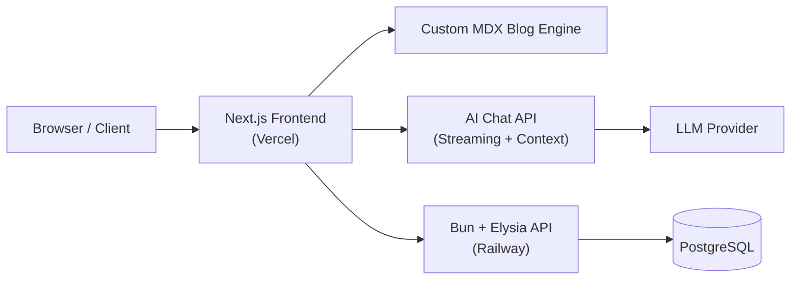
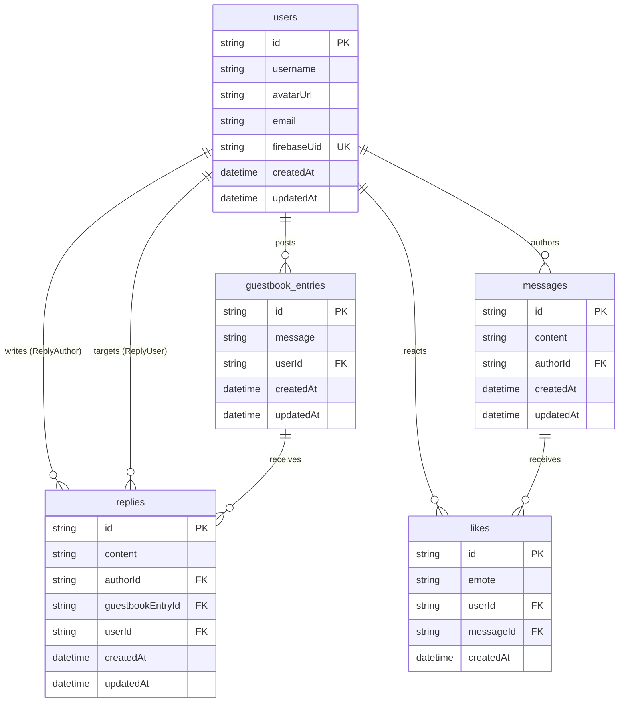

# Personal Website

A high-performance personal web application featuring a project portfolio, technical blog, guestbook, and an interactive AI chat interface.

**Live Site:** [kiril.is-a.dev](https://kiril.is-a.dev)

---

## Key Highlights & Features

- **High-Performance Portfolio & MDX Blog Engine:** Built with a custom MDX blog engine to publish articles on backend development, system design, and software architecture, achieving a **99+ Lighthouse score**.
- **AI Chatbot Assistant:** Integrated an interactive AI chat interface featuring **streaming responses**, **multi-turn context**, and **cost-optimized prompt engineering**.
- **Guestbook Service:** Shipped a high-performance guestbook service powered by **Bun** and **Elysia** with **PostgreSQL** persistence.
- **Technical Blog:** Dedicated space for sharing notes and guides on backend engineering, system design, and software architecture.

---

## Architecture



---

## Database Schema



---

## Tech Stack

* **Frontend:** Next.js, TypeScript, MDX, Tailwind CSS
* **Backend:** Bun, Elysia, PostgreSQL, Prisma
* **AI & Infrastructure:** LLM Integration, Serverless, Docker
* **Deployment:** Vercel (Frontend), Railway (Backend)

---

## Project Structure

```text
├── backend/    # Bun/Elysia server, Prisma schema, and API routes
└── frontend/   # Next.js application, MDX blog engine, AI chat, and UI components

```

---

## License

This project is licensed under the MIT License.
